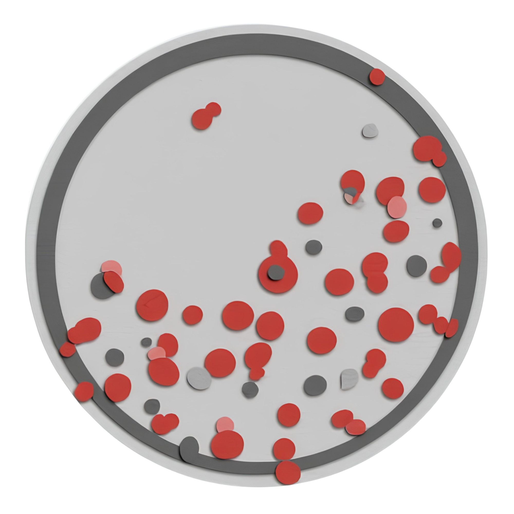

::: {.page-card}
# Courses {.unnumbered .unlisted}

A portfolio of featured courses that exemplify inquiry-driven learning, open pedagogy, and evidence-based teaching practices in microbiology and biotechnology education.
:::

These cards highlight current courses. Use a linked title or **Visit Course** button to open a course website.

```{=html}
<div class="course-grid">

  <!-- HON 312 -->
  <div class="course-card">
    <div class="course-card-body">
      <h2 class="course-title">
        <a href="https://go.ncsu.edu/outbreak" target="_blank" rel="noopener">
          HON 312: Outbreak
        </a>
      </h2>
      <p class="course-meta">NC State University · University Honors Program</p>
      <p class="course-desc">
        An Honors course focused on outbreaks and the science behind them.
      </p>
      <a class="course-btn" href="https://go.ncsu.edu/outbreak" target="_blank" rel="noopener">
        Visit Course ↗
      </a>
    </div>
  </div>

  <!-- LSC 101 -->
  <div class="course-card">
    <div class="course-card-body">
      <h2 class="course-title">LSC 101: Critical and Creative Thinking in Life Sciences</h2>
      <p class="course-meta">NC State University · Life Sciences First Year Program</p>
      <p class="course-desc">
        Develop critical and creative thinking skills through the study and practice of life sciences.
      </p>
    </div>
  </div>

  <!-- Microbial Superheroes / Delftia Book -->
  <div class="course-card">
    <div class="course-card-body">
      <h2 class="course-title">
        <a href="https://go.ncsu.edu/delftiabook" target="_blank" rel="noopener">
          Microbial Superheroes | LSC 170
        </a>
      </h2>
      <p class="course-meta">NC State University · Department of Biological Sciences</p>
      <p class="course-desc">
        A course built around an open educational resource (the <em>Delftia</em> book) that
        engages students in exploring microbial superpowers—from gold biomineralization to
        antibiotic resistance—through collaborative, inquiry-driven learning.
      </p>
      <a class="course-btn" href="https://go.ncsu.edu/delftiabook" target="_blank" rel="noopener">
        Visit Course ↗
      </a>
    </div>
    <div class="course-logo">
      <a href="https://go.ncsu.edu/delftiabook" target="_blank" rel="noopener" aria-label="Open Microbial Superheroes course website">
        
      </a>
    </div>
  </div>

  <!-- MB 360 -->
  <div class="course-card">
    <div class="course-card-body">
      <h2 class="course-title">
        <a href="https://go.ncsu.edu/mb360" target="_blank" rel="noopener">
          MB 360: Inquiry at the Bench
        </a>
      </h2>
      <p class="course-meta">NC State University · Department of Biological Sciences</p>
      <p class="course-desc">
        An inquiry-focused microbiology course centered on investigating scientific questions at the bench.
      </p>
      <a class="course-btn" href="https://go.ncsu.edu/mb360" target="_blank" rel="noopener">
        Visit Course ↗
      </a>
    </div>
    <div class="course-logo">
      <a href="https://go.ncsu.edu/mb360" target="_blank" rel="noopener" aria-label="Open MB 360 course website">
        
      </a>
    </div>
  </div>

  <!-- MyCOED -->
  <div class="course-card">
    <div class="course-card-body">
      <h2 class="course-title">
        <a href="https://go.ncsu.edu/mycoed" target="_blank" rel="noopener">
          BSC 495: The Hidden World's Code — Fungal Genomics
        </a>
      </h2>
      <p class="course-meta">NC State University</p>
      <p class="course-desc">
        Explore fungal genomics and the hidden biological information encoded in fungal genomes.
      </p>
      <a class="course-btn" href="https://go.ncsu.edu/mycoed" target="_blank" rel="noopener">
        Visit Course ↗
      </a>
    </div>
    <div class="course-logo">
      <a href="https://go.ncsu.edu/mycoed" target="_blank" rel="noopener" aria-label="Open MycoEd course website">
        
      </a>
    </div>
  </div>

</div>
```
